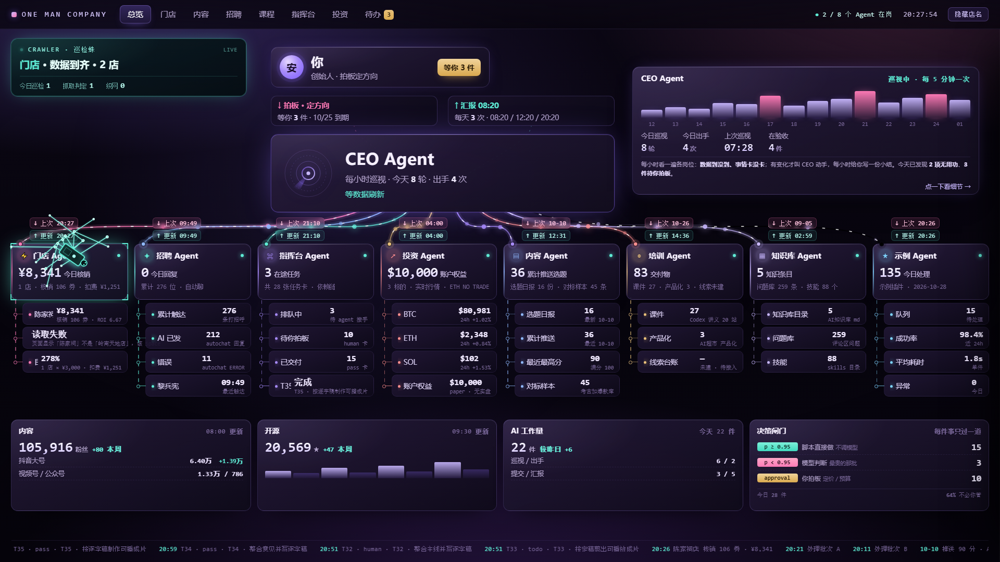

# AI 指挥舱 · Cockpit

> 一个 HTML 看板 + N 个业务插件。**加一个 Agent = 建一个文件夹放两个文件，框架零改动。**



一套**插件化**的业务监控台：框架本身不认识任何业务，所有内容由 `agents/` 下的插件提供。

---

## 一分钟上手

| 想做什么 | 双击 |
|---|---|
| 看大屏（只读，不需要服务） | `index.html` |
| 看大屏 + 能点动作 | `指挥舱.bat` |
| 立刻重新采集一次 | `刷新一次.bat` |
| 让数据自动更新 | `python install_tasks.py` |
| 录课/演示（隐藏操作、数据美化） | `index.html?mode=demo` |

---

## 加一个 Agent = 建一个文件夹

在 `agents/` 下新建目录（例如 `agents/wechat/`），放两个文件即可。**框架零改动。**

### 1. `agent.json` —— 元数据

```json
{
  "id": "wechat",
  "name": "私域",
  "icon": "✉",
  "color": "#7dd3fc",
  "order": 8,
  "interval": 600,
  "timeout": 30,
  "metric": { "label": "今日新增", "unit": "人" },
  "actions": [
    { "id": "refresh", "label": "刷新", "confirm": "重新读取私域数据？" }
  ],
  "demo": {
    "status": "ok",
    "metric": { "label": "今日新增", "value": 23, "unit": "人" },
    "items": [{ "name": "群人数", "value": "1,204", "note": "+23", "tone": "ok" }]
  }
}
```

| 字段 | 必填 | 说明 |
|---|---|---|
| `id` | ✅ | 必须和目录名一致 |
| `name` | ✅ | 卡片标题（2–4 字最佳） |
| `icon` | | 一个字符，建议 emoji 或符号 |
| `color` | | 卡片主色，`#rrggbb` |
| `order` | | 排列顺序，小的在左 |
| `interval` | | 采集间隔（秒），默认 300 |
| `timeout` | | 单次采集超时（秒），超过判定失败 |
| `heavy` | | 标 `true` 表示慢/易崩（如要开浏览器），建议单独间隔 |
| `metric` | | 大数字的标签和单位 |
| `actions` | | 可执行动作白名单，**没声明的动作一律拒绝** |
| `demo` | | `?mode=demo` 时替换的数据，不给就用真实数据 |

### 2. `fetch.py` —— 采集逻辑

```python
def fetch(ctx):
    """必须返回 dict。框架会做字段校验和截断。"""
    return {
        "status": "ok",              # ok | stale | weak | down | unplugged
        "metric": {"value": 23, "unit": "人"},
        "sub": "群 12 个 · 活跃 340",
        "items": [                   # 最多 6 条，屏上显示前 4 条
            {"name": "群人数", "value": "1,204", "note": "+23", "tone": "ok"},
        ],
        "events": [                  # 最多 12 条，驱动 ticker 和抽屉
            {"at": "20:15", "kind": "dispatch", "text": "推送 3 条内容"},
        ],
        "todo": [{"text": "回复 5 条未读", "pri": "P1"}],
        "gate": {"auto": 0, "model": 0, "human": 1},   # 可选：给闸门计数
    }
```

**`ctx` 工具箱**（按需用，不用全看）：

| 方法 | 用途 |
|---|---|
| `ctx.now()` | `"20:15"` |
| `ctx.log(msg)` | 写 `agents/<id>/run.log`（自动滚动，超 400KB 转 `.1`） |
| `ctx.cache` | 上次成功的原始返回（dict），失败时可参考 |
| `ctx.read_json(path, default)` | 安全读 JSON |
| `ctx.http(url, timeout)` | 无代理 GET（国内**必须**绕代理，否则币安会超时） |
| `ctx.http_json(url)` | GET + 解析 JSON |
| `ctx.browser(space, page)` | 返回 `mt.ego.EgoCDP`，给需要开浏览器的重型插件 |
| `ctx.path(*parts)` | `agents/<id>/xxx` 的绝对路径 |

### 3.（可选）实现动作

```python
def act(ctx, action_id, payload):
    if action_id == "refresh":
        return {"ok": True, "msg": "已刷新"}
    return {"ok": False, "msg": f"未实现：{action_id}"}
```

动作只会在 `agent.json` 的 `actions` 里声明过的 id 才被执行，且**全部写进 `audit.jsonl`**（时间 / 插件 / 动作 / 结果 / IP）。

---

## 目录结构

```
console/
├── index.html            大屏（框架，不含业务）
├── serve.py              本地服务：/api/state /api/act /api/audit
├── 指挥舱.bat            启动服务（带动作）
├── 刷新一次.bat          手动全量采集
├── install_tasks.py      注册 Windows 计划任务
├── core/
│   ├── schema.py         数据契约 + 校验 + 截断
│   ├── runner.py         单插件执行器（独立进程 / 超时 / 降级）
│   └── aggregate.py      聚合 → state.json + state.js
├── agents/
│   └── <id>/
│       ├── agent.json    元数据
│       ├── fetch.py      采集（+ 可选 act）
│       ├── out.json      ← 运行结果（自动生成）
│       ├── run.log       ← 日志（自动生成）
│       └── .cache.json   ← 上次成功（自动生成，别手改）
├── state.json / state.js ← 大屏唯一读的（自动生成）
└── audit.jsonl           ← 动作审计（自动生成）
```

---

## 三条设计约束（改之前先读）

**1. 大屏永远不读业务系统。**
它只读 `state.json`。所有格式差异、路径差异、异常处理都关在插件里。这条保证换任何数据源都不动前端。

**2. 插件崩溃不能拖垮大屏。**
每个插件跑在独立进程里，有超时。失败时用 `.cache.json` 里上次成功的数据顶上，状态降级为 `stale`，并在卡片上标「沿用 X 分钟前」。整块屏永远有东西看。

**3. 动作必须白名单 + 审计。**
`act()` 只接受 `agent.json` 里声明过的 id。任何写操作都会留下 `audit.jsonl` 记录。危险动作在 `agent.json` 里标 `"danger": true`，前端会渲染成红色按钮并强制二次确认。

---

## 状态语义

| status | 含义 | 卡片表现 |
|---|---|---|
| `ok` | 正常，数据新鲜 | 正常色 |
| `stale` | 数据超过阈值没更新，或本次采集失败用了缓存 | 黄色 |
| `weak` | 部分可用（如只读到 1/2 家店、只有产出量没线索量） | 黄色 |
| `down` | 停了 / 长时间没动 | 红色 |
| `unplugged` | 插件还没跑过 | 灰化虚线 |

---

## 常见问题

**Q：改了 `agent.json` 要重启吗？**
不用。下次采集自动生效；大屏 60 秒内会刷到。

**Q：动作按钮是灰的 / 点了没反应？**
说明是双击 `index.html` 打开的（`file://` 模式下浏览器不允许触发本地程序）。改用 `指挥舱.bat`。

**Q：某个插件一直 `down`？**
看 `agents/<id>/run.log`，里面记录了异常堆栈。常见是路径写错、数据源没在跑、需要登录。

**Q：想临时停掉某个 Agent？**
把 `agents/<id>/agent.json` 改名成 `agent.json.off`，或直接删掉 `out.json` 并把 status 写死 `unplugged`。想彻底移除就删整个目录。

**Q：`store` 插件为什么要 80 秒？**
它要开 ego 浏览器读美团后台（两家店 + 收钱助手）。这类插件标 `heavy`，间隔设 600 秒，不要跟轻量插件同频。

---

## 打包给粉丝之前（发布 checklist）

这套东西的设计目标是**别人拿到就能接自己的业务**。发布前请逐条确认：

### ✅ 必须做的

- [ ] **删掉 `config.json`**（它含你的本机路径、poi、BSID）。粉丝拿到 `config.example.json` 自己复制改名即可
- [ ] **决定 `agents/` 里留哪些插件**
  - 只留 `hello/` → 最干净，粉丝从零写自己的
  - 留 `hello/` + 脱敏后的业务插件 → 有真实范例，但要确认注释里没有公司名/账号
- [ ] **删掉运行产物**：`agents/*/out.json`、`run.log`、`.cache.json`、`.stores.json`、`state.json`、`state.js`、`audit.jsonl`。`.gitignore` 已覆盖，但手动清一次更保险
- [ ] **确认 `LICENSE` 里的版权人写对了**
- [ ] 全仓库搜一遍敏感词：你的店名、账号、手机号、`BSID=`、`poi`

### 建议做的

- [ ] 配一张截图放 `docs/screenshot.png`，README 顶部引用
- [ ] 录一段 60 秒演示（加一个插件 → 屏上多一列），放 README
- [ ] 写一节「我的使用场景」说明你为什么做这个，比功能列表更有说服力

### 粉丝的第一次运行

```
1. 装 Python 3.9+（勾 Add to PATH）
2. 解压，双击 刷新一次.bat      → 看到「示例」这一列有数，说明框架通了
3. 复制 config.example.json 为 config.json，填自己的路径
4. 改 agents/hello/ 成自己的业务
5. 双击 指挥舱.bat              → 有动作能力
6. python install_tasks.py      → 挂定时任务（可选）
```

**第 2 步是关键**：如果粉丝双击 `刷新一次.bat` 后看到「示例」那一列在跑，说明环境没问题，剩下只是填自己数据的事。

---

## 为什么这样设计（给要看代码的人）

**为什么插件是「目录 + 两个文件」而不是 pip 包？**
pip 包要打包、发版、装依赖；目录形式复制粘贴就能加，删目录就是卸载，对非程序员也友好。

**为什么采集放独立进程？**
浏览器类插件（如美团）会卡、会崩、会占几十秒。同进程会让整块屏停摆。独立进程 + 超时，最坏情况只是那一列变色。

**为什么大屏不直接读业务系统？**
业务系统的输出格式是最不稳定的东西（日志会改版、字段会重命名、路径会挪）。把它挡在插件里，换数据源不动前端一行代码。

**为什么动作要本地服务？**
`file://` 协议下浏览器不允许 JS 调本地程序，这是安全策略，绕不过去。所以只读和大屏解耦，动作单独走 `serve.py`。

**为什么 state 同时输出 .json 和 .js？**
`.js` 是给双击打开的降级模式用的（`<script src>` 不受 CORS 限制），`.json` 是给服务模式和外部程序用的。
